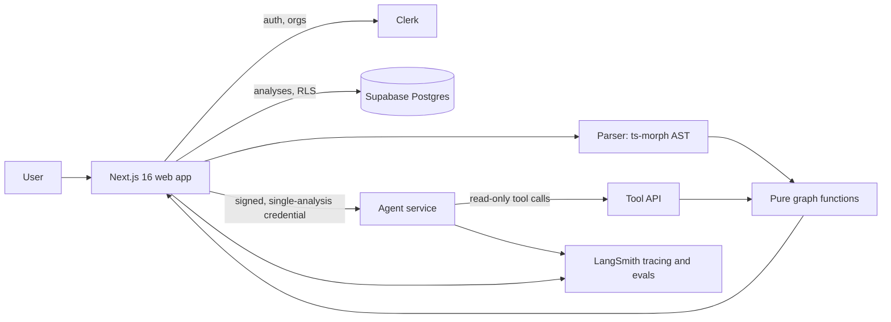

<div align="center">

# 🧵 CodeLoom

### Weave any codebase into a map you can trust.

**CodeLoom turns any public TypeScript or JavaScript repository into an interactive dependency map. Every node and edge comes from real code analysis, never from an AI's guess.**


</div>

---

## 📋 Table of Contents

1. [Introduction](#-introduction)
2. [The Problem](#-the-problem)
3. [Core Principle](#-core-principle)
4. [Features](#-features)
5. [Use Cases](#-use-cases)
6. [How It Works (End to End)](#-how-it-works-end-to-end)
7. [Architecture](#-architecture)
8. [Tech Stack](#-tech-stack)
9. [Project Structure](#-project-structure)
10. [Quick Start](#-quick-start)
11. [Environment Variables](#-environment-variables)
12. [Security Model](#-security-model)
13. [Evaluation and Observability](#-evaluation-and-observability)
14. [What CodeLoom Deliberately Doesn't Do](#-what-codeloom-deliberately-doesnt-do)

---

## ✨ Introduction

Modern teams ship code faster than they can read it. With AI-generated code in the mix, it's easy to end up with a codebase full of hidden imports, tangled modules and files nobody fully understands.

**CodeLoom** parses a repository's real source code into a navigable graph of files (nodes) and the imports between them (edges). You can see how a project is structured, find out what breaks before you change a file, and ask questions about the architecture. The answers are grounded in verified structure, not guesses.

Paste a GitHub URL, and a few moments later you're looking at an interactive map of the whole repository.

## 🧩 The Problem

| Pain point | What it looks like day to day |
| --- | --- |
| **Opaque codebases** | Onboarding onto a new repo means hours of clicking through folders and following imports by hand. |
| **Risky changes** | "If I edit this file, what else breaks?" is usually answered by guessing, or by finding out in production. |
| **Untrustworthy AI answers** | Chatbots that explain code often invent files, functions and relationships that don't exist. |
| **Hidden coupling** | Re-exports, dynamic imports and `require()` calls hide real dependencies from a quick skim. |

## 🎯 Core Principle

> **Every node and edge on the canvas comes from real code analysis. The AI never decides what is connected to what.**

This one rule shapes the whole design:

- **Structure is deterministic.** The graph is built by parsing source code into an abstract syntax tree (AST), not by prompting a model.
- **Graph arithmetic is pure code.** Blast radius, neighbours and transitive walks are ordinary functions over the graph, with exact answers.
- **The AI only explains and summarizes verified structure.** It can describe what the graph says. It cannot add to it.
- **Hallucinations are checkable.** Any file path in an AI explanation can be tested against the exact set of paths the model was shown, using set membership rather than another model.

## 🔋 Features

### 🗺️ AST codebase parsing
Converts a public GitHub repository into a complete node-and-edge graph. It follows imports, re-exports, dynamic imports and `require()` calls using the TypeScript Compiler API (via `ts-morph`).

### 🖱️ Interactive canvas
Zoom around the map, expand folders into individual files, and select any module to see its incoming and outgoing dependencies. Rendered with React Flow and laid out with dagre.

### 💥 Blast radius
Select a file and instantly see every file and downstream module that would be affected if it changed. This is plain graph traversal, so the result is exact and instant.

### 📝 Grounded module explanations
Get a plain-language summary of any file, generated only from its real AST connections. Every filename mentioned in an explanation links back to the matching node on the map.

### 🤖 Agentic repository chat
An "Ask" mode for the whole repository. The agent works by calling tools that query the graph, walking verified paths step by step, and **each tool call is shown live as it happens**. Typical questions:

- *"Where is authentication handled?"*
- *"What breaks if I change that?"*
- *"Which files are API routes?"*

If a question can't be answered from the graph (for example, "is this code any good?"), the agent declines and says what it *can* answer.

### 👥 Multi-tenant organizations
Analyses belong to a Clerk organization, so a whole team shares one map of the same codebase.

### 🔒 Row-level data isolation
Supabase Postgres Row-Level Security policies, evaluated against Clerk JWT claims, keep each team's data separate at the database level.

### 📈 Full observability
Every LLM call is traced in LangSmith, with evaluations that score answer quality as a number rather than an opinion.

### 🌗 Polished marketing site
A signed-out landing page with a repo-URL field in the hero, drawn (not screenshotted) illustrations, and light and dark themes that share the product's design tokens.

## 💼 Use Cases

**🧭 Onboarding to an unfamiliar codebase:**
New hires and open-source contributors can see the architecture in minutes instead of days, then ask the agent where things live.

**🛡️ Safer refactoring and code review:**
Check a file's blast radius before touching it. Reviewers can see what a pull request really reaches, beyond what's in the diff.

**🤖 Auditing AI-generated code:**
When much of the code was written by an assistant, CodeLoom shows what was actually produced and how it all fits together, using real structure instead of a model's summary.

**🏗️ Architecture and tech-debt reviews:**
Spot tightly coupled modules, hub files that everything depends on, and tangled import chains that make good refactoring targets.

**📚 Documentation and knowledge sharing:**
Give teammates an always-accurate map and grounded explanations, instead of diagrams that go stale a week after someone draws them.

**🔍 Evaluating open-source dependencies:**
Before adopting or forking a library, explore how its internals are organized.

**🎓 Teaching and learning:**
Show students how real-world projects are structured by walking through a live dependency graph.

## 🔄 How It Works (End to End)

```text
 GitHub URL ─► Sign in (Clerk) ─► Fetch repo ─► Parse (ts-morph / AST)
                                                      │
                                                      ▼
                                    Graph of files + import edges
                                                      │
                          ┌───────────────────────────┼───────────────────────────┐
                          ▼                           ▼                           ▼
                 Interactive canvas           Blast radius &              Grounded AI explanations
                 (React Flow + dagre)         graph queries               + agentic repository chat
                                           (pure graph functions)        (tools call the same graph)
                          │                           │                           │
                          └──────────────► Stored in Supabase (RLS) ◄─────────────┘
                                                      │
                                          Traced & evaluated in LangSmith
```

1. **Submit a repository.** Paste a public GitHub URL on the landing page. The field goes straight into sign-in and then the analysis.
2. **Authenticate.** Clerk handles identity and organization membership.
3. **Parse.** `ts-morph` reads the source and extracts files plus every import, re-export, dynamic import and `require()` into nodes and edges.
4. **Classify.** Conventions assign file roles (for example routes) where they can be known with certainty, and a route table is built for supported frameworks.
5. **Store.** The analysis is saved in Supabase, scoped to the user's organization and protected by Row-Level Security.
6. **Explore.** The canvas renders the graph. Selecting a file shows its structure, blast radius and a grounded explanation.
7. **Ask.** The chat panel talks to a separate agent service. The agent calls read-only tools backed by the same graph functions that draw the canvas, and its steps stream back to the UI.
8. **Measure.** LangSmith traces every model call, and evaluators score answers against exact ground truth.

## 🏛️ Architecture



A few design decisions worth knowing:

- **The agent runs as its own service**, separate from the web app, and is reached over HTTP. It handles threads and streaming itself, so none of that is hand-written in the app.
- **The agent has six read-only tools:** a summary of the whole analysis, search files by part of a path, list files by role, direct neighbours of a file, a transitive walk in either direction, and the route table.
- **The tools reuse the canvas's graph functions** instead of reimplementing them, so the chat and the map can never disagree.
- **The agent is never told which analysis it's reading.** The analysis is encoded in a short-lived signed credential scoped to exactly one analysis and its organization. A malicious comment inside someone's source code can't redirect the agent to another analysis, because that's impossible rather than just unlikely.
- **If the agent is unreachable, the rest of the app keeps working.** The map, the pane, blast radius and explanations don't depend on it.
- **Ask is a mode of the whole right-hand pane**, not a third tab, because a question about a repository isn't a question about one selected file.

## ⚙️ Tech Stack

| Layer | Technology | Role |
| --- | --- | --- |
| Framework | **Next.js 16** (App Router, Server Actions) | Full-stack React application |
| Language | **TypeScript 5** | Type safety across app and parser pipeline |
| Parsing | **ts-morph** | Wraps the TypeScript Compiler API to build deterministic AST graphs |
| Visualization | **React Flow (@xyflow/react)** + dagre | Interactive canvas and graph layout |
| Auth | **Clerk** | Identity and multi-tenant organizations |
| Database | **Supabase (Postgres)** | Storage with Row-Level Security via JWT claims |
| AI | **OpenAI SDK** | Grounded explanations and the repository agent |
| Observability | **LangSmith** | LLM tracing, datasets and evaluations |
| Styling | **Tailwind CSS v4** | Dense, high-information developer UI |
| Code review | **CodeRabbit** | Automated pull-request review |

## 🗂️ Project Structure

```text
codeloom/
├── app/                  # Next.js App Router: pages, routes, server actions
├── components/           # UI: canvas, panes, chat panel, landing page
├── lib/                  # Parser, graph functions, auth helpers, shared logic
├── types/                # Shared TypeScript types
├── scripts/              # Scripts that load the app environment (e.g. evals)
├── supabase/migrations/  # Database schema and Row-Level Security policies
├── deep-agent/           # Standalone agent service (run with `pnpm dev` there)
├── docs/                 # Build-phase specs and project documentation
├── public/               # Static assets
├── proxy.ts              # Request proxy / middleware
├── .env.example          # Environment variable template
└── package.json
```

## 🤸 Quick Start

### Prerequisites

- [Git](https://git-scm.com/)
- [Node.js](https://nodejs.org/en)
- [pnpm](https://pnpm.io/)
- Accounts for [Clerk](https://clerk.com/), [Supabase](https://supabase.com/), [OpenAI](https://platform.openai.com/) and [LangSmith](https://smith.langchain.com/)

### Install

```bash
git clone https://github.com/dalaldia5/CodeLoom.git
cd codeloom
pnpm install
```

### Configure

Create a `.env.local` file in the project root using the variables below, then fill in your own keys.

### Run the web app

```bash
pnpm dev
```

Open [http://localhost:3000](http://localhost:3000).

### Run the agent service (for the Ask panel)

In a second terminal:

```bash
cd deep-agent
pnpm dev
```

The web app finds it through `AGENT_URL` (default `http://localhost:2024`).

## 🔐 Environment Variables

```bash
# CLERK
NEXT_PUBLIC_CLERK_SIGN_IN_URL=/sign-in
NEXT_PUBLIC_CLERK_SIGN_UP_URL=/sign-up
NEXT_PUBLIC_CLERK_SIGN_IN_FALLBACK_REDIRECT_URL=/
NEXT_PUBLIC_CLERK_SIGN_UP_FALLBACK_REDIRECT_URL=/
NEXT_PUBLIC_CLERK_PUBLISHABLE_KEY=
CLERK_SECRET_KEY=

# SUPABASE
NEXT_PUBLIC_SUPABASE_URL=
NEXT_PUBLIC_SUPABASE_PUBLISHABLE_KEY=
SUPABASE_SECRET_KEY=

# LANGSMITH
LANGSMITH_TRACING=true
LANGSMITH_API_KEY=
LANGSMITH_PROJECT=codeloom
LANGSMITH_ENDPOINT=https://api.smith.langchain.com

# OPENAI
OPENAI_API_KEY=

# AGENT SERVICE
AGENT_URL=http://localhost:2024
```

> ⚠️ Never commit `.env.local`. Keep secret keys (`CLERK_SECRET_KEY`, `SUPABASE_SECRET_KEY`, `OPENAI_API_KEY`, `LANGSMITH_API_KEY`) out of version control.

## 🛡️ Security Model

- **Tenant isolation at the database.** Row-Level Security policies check Clerk JWT claims, so one organization can't read another's analyses, even if application code has a bug.
- **No all-powerful credential in the agent path.** The agent receives a short-lived signed token naming exactly one analysis and its organization, and it reads through a read-only tool surface.
- **Untrusted input is expected.** The entire input to CodeLoom is other people's source code, so prompt-injection attempts hidden in comments are treated as realistic, and the design makes them ineffective instead of relying on the model to resist them.
- **The agent can query, not infer.** If a tool were ever added that lets the agent infer a relationship instead of querying one, the core principle would be broken. That's the line the project holds.

## 📈 Evaluation and Observability

Answer quality is measured, not eyeballed:

- **Invented-path check.** Every path-shaped token in an explanation is tested against the exact set of paths the model was shown. Anything else was invented. This is deterministic set membership, not a model grading a model, and it can run as a live evaluator against real traffic.
- **Role accuracy.** Files whose role is known with certainty by convention act as held-out ground truth. The role is hidden, the model is asked, and the answer is compared against the known role.
- **Prompt versions.** Two explanation prompts are run over the same dataset as separate experiments and scored side by side. Judging "is this specific enough to be useful" does need a model as judge, and the results are presented with that limitation stated plainly.
- **Agent behaviour evals.** Checks for whether the agent hedges instead of looking something up, and whether it talks about its own plumbing.
- **Tracing.** Every LLM call is traced in LangSmith.

## 🚫 What CodeLoom Deliberately Doesn't Do

Being clear about limits is part of being trustworthy:

- It **doesn't guess edges.** If a connection isn't in the parsed code, it isn't on the map.
- It **doesn't judge code quality.** Questions like "is this code any good?" are declined, with an explanation of what the tool can answer instead.
- It **doesn't claim to understand every language.** CodeLoom targets public TypeScript and JavaScript repositories.
- It **doesn't use fake social proof.** No invented testimonials, logos or claims about features that don't exist.

---

<div align="center">

**CodeLoom: see the whole fabric, thread by thread.**

</div>
